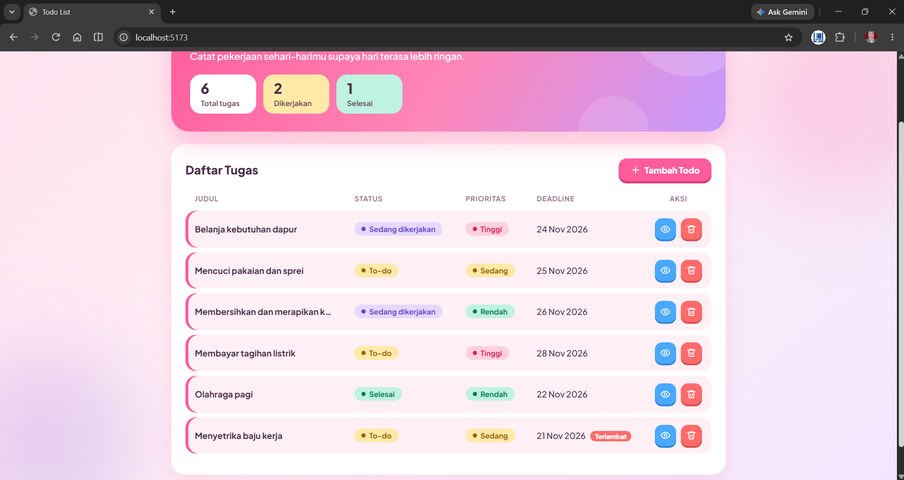
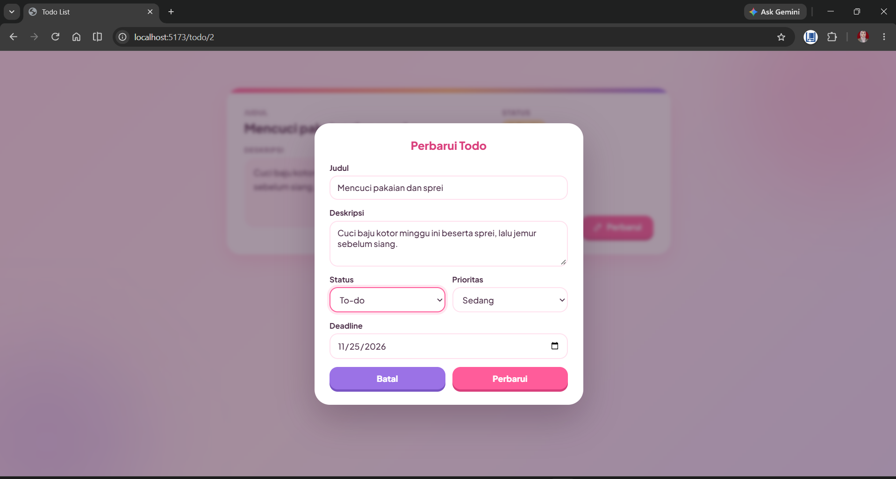

# Todo List — React.js

Aplikasi **Todo List** (frontend saja) untuk Kuis Praktikum Pengembangan Frontend.
Dibangun dengan **React.js + Vite + Tailwind CSS**, memakai data dummy dan React State, tanpa backend / REST API.

## Fitur

- **Menampilkan tugas** — tabel berisi Judul, Status, Prioritas, Deadline, dan Aksi
- **Melihat detail tugas** — halaman `/todo/:id` berisi informasi lengkap
- **Menambahkan tugas** — lewat formulir modal (dengan validasi)
- **Memperbarui tugas** — formulir modal dari halaman detail
- **Menghapus tugas** — dengan dialog konfirmasi
- **Umpan balik** — notifikasi (toast) setiap tambah / ubah / hapus
- Semua perubahan langsung tampil tanpa reload (React State + Context)

## Struktur Data

```js
{
  id: 1,                       // identitas unik
  title: "Judul tugas",
  description: "Deskripsi tugas",
  priority: "low",             // low | medium | high
  deadline: "2026-12-11",      // format YYYY-MM-DD
  status: "to-do"              // to-do | in progress | done
}
```

Nilai `status` dan `priority` sengaja dibiarkan dalam bahasa Inggris agar
mudah disambungkan ke REST API; tampilan di UI diterjemahkan ke Bahasa Indonesia.

## Rencana Integrasi REST API

Semua operasi data ada di `src/context/TodoContext.jsx`
(`addTodo`, `updateTodo`, `deleteTodo`, `getTodo`), sehingga nanti cukup
mengganti isinya dengan pemanggilan:

- `GET /api/todos` — ambil semua tugas
- `GET /api/todos/:id` — ambil tugas berdasarkan ID
- `POST /api/todos` — tambah tugas
- `PUT /api/todos/:id` — perbarui tugas
- `DELETE /api/todos/:id` — hapus tugas

## Cara Menjalankan

```bash
npm install
npm run dev
```

Buka `http://localhost:5173`.

## Struktur Folder

```
src/
├── components/   # Modal, form, dialog konfirmasi, badge, toast, ikon, dekorasi
├── context/      # TodoContext (state & operasi CRUD)
├── data/         # Data dummy
├── pages/        # Halaman daftar & detail
├── utils/        # Format tanggal, label status/prioritas
├── App.jsx
├── main.jsx
└── styles.css     # Tailwind + tema
```

## Screenshot






