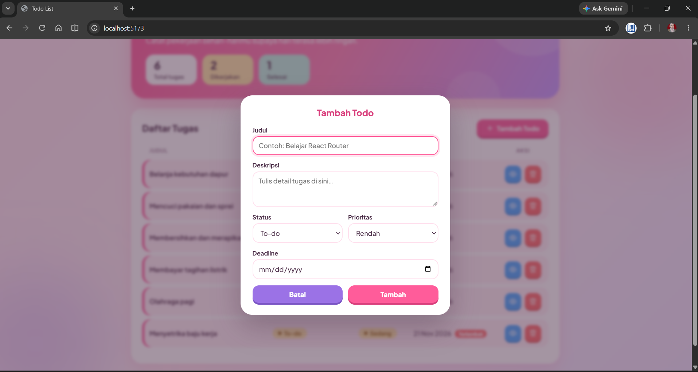
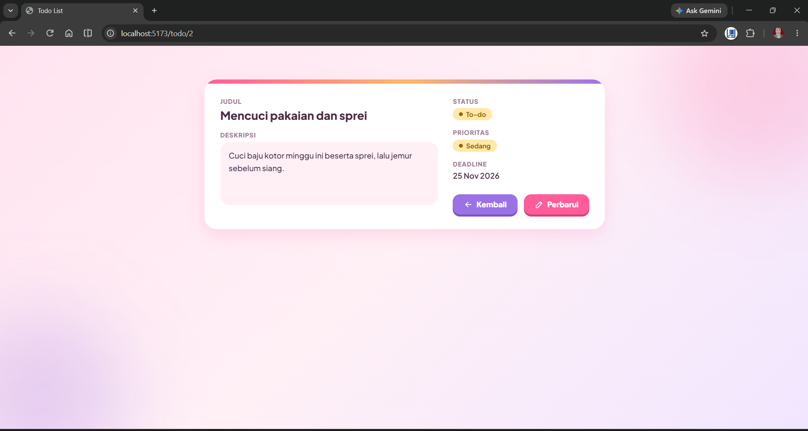
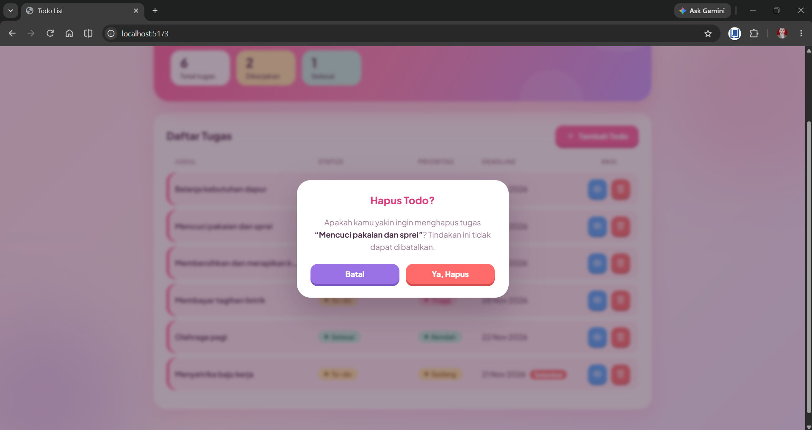

##APLIKASI TODO-LIST

## Fitur

- **Menampilkan tugas** — tabel berisi Judul, Status, Prioritas, Deadline, dan Aksi
- **Melihat detail tugas** — halaman `/todo/:id` berisi informasi lengkap
- **Menambahkan tugas** — lewat formulir modal (dengan validasi)
- **Memperbarui tugas** — formulir modal dari halaman detail
- **Menghapus tugas** — dengan dialog konfirmasi
- **Umpan balik** — notifikasi (toast) setiap tambah / ubah / hapus
- Semua perubahan langsung tampil tanpa reload (React State + Context)

## Screenshot

